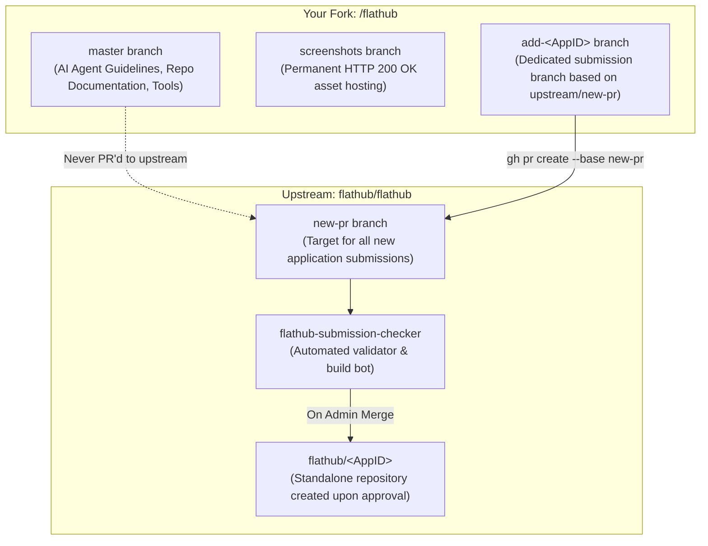

# Flathub Submission Guide for AI Agents & Developers
<!-- Generic Blueprint for Flathub Application Onboarding -->

> **CRITICAL DIRECTIVE FOR AI AGENTS**:
> Never submit pull requests to Flathub (`flathub/flathub`) without verifying **EVERY SINGLE RULE** in this document. 
> Flathub employs automated bots (`flathub-submission-checker`, `vorarbeiter`) and strict linters (`flatpak-builder-lint`, `appstreamcli`). 
> Over 85% of rejected Flathub submissions stem from line-ending mismatches, word-wrapped checklists, and minor syntax violations detailed below.

---

## 1. Branch Strategy & Repository Architecture

When submitting a new application, you work with a fork of [`flathub/flathub`](https://github.com/flathub/flathub).



### Branch Roles & Separation
| Branch | Role | Permitted Contents | Merge Destination |
| :--- | :--- | :--- | :--- |
| `master` | **Default landing branch** | Documentation (`AGENTS.md`, `README.md`), automation scripts. | None (Kept in your fork; never submitted upstream). |
| `screenshots` | **Public Asset CDN** | Raw `.png` screenshots for AppStream metadata. | None (Dedicated asset branch). |
| `add-<AppID>` | **Ephemeral Submission Branch** | **ONLY** the required Flatpak files: `<AppID>.yaml`, `<AppID>.metainfo.xml`, `<AppID>.desktop`, `flathub.json`, and `icons/`. | PR targeting `flathub/flathub:new-pr`. |

> [!CAUTION]
> **NEVER** include `AGENTS.md`, scratch scripts, or general documentation in the `add-<AppID>` submission branch.
> When a submission is merged, Flathub instantiates the new official repository `flathub/<AppID>` directly from your submission branch. Any extraneous files pollute the package repository and can trigger linter rejections.

---

## 2. The 8 Pillars of Zero-Error Submissions

### Rule 1: The Base Branch MUST be `new-pr`
- **Target**: `flathub/flathub:new-pr` (NOT `master`!).
- Flathub deprecated `master` for submissions. Opening against `master` triggers `.github/workflows/close-master-prs.yml` which automatically closes the PR within seconds.
- **Git Setup**:
  ```bash
  git remote add upstream https://github.com/flathub/flathub.git
  git fetch upstream new-pr
  git checkout -B add-<AppID> upstream/new-pr
  ```

---

### Rule 2: PR Title Must Strictly Match Regex `^Add\s+<AppID>$`
Flathub's submission bot parses the application ID directly from the PR title using:
```python
# From flathub-submission-checker
re.match(r"^Add\s+([A-Za-z0-9_-]+(\.[A-Za-z0-9_-]+)+)$", title)
```

- ✅ **CORRECT**:
  ```text
  Add org.example.MyApp
  ```
- ❌ **WRONG** (Triggers bot errors or instant closure):
  - `Add org.example.MyApp v1.0.0` *(No version numbers!)*
  - `[NEW] Add org.example.MyApp` *(No tags or prefixes!)*
  - `Add org.example.MyApp: Awesome Tool` *(No app descriptions or colons!)*
  - `add org.example.MyApp` *(Must start with uppercase `Add`!)*

---

### Rule 3: Single-Line Checklist in PR Body (No Word-Wrapping)
The Flathub bot checks every item with strict line-by-line regex:
```python
CHECKLIST_PATTERN = re.compile(r"^[ \t]*[-+*][ \t]+\[([ xX])\][ \t]*(.+?)\s*$")
```
It splits the PR body with `pr_body.splitlines()` and examines each line independently.

> [!WARNING]
> **THE WORD-WRAP PITFALL**:
> Automated code formatters, Markdown linters, and AI text generators frequently hard-wrap long lines at 80 or 100 characters. 
> If a checklist item wraps onto a second line, the second line lacks `[- [x]]`, truncating the text and causing the bot to fail checklist validation!
>
> ❌ **WRONG (Wrapped across two lines)**:
> ```markdown
> - [x] The application has a meaningful development history, evidence of
>   real-world use, and a clear commitment to ongoing maintenance.
> ```
> ✅ **CORRECT (One unbroken continuous line)**:
> ```markdown
> - [x] The application has a meaningful development history, evidence of real-world use, and a clear commitment to ongoing maintenance, as required by the [development history requirements][history].
> ```

#### Standard Submission Template:
```markdown
<!-- ⚠️⚠️  Submission pull request MUST be made against the `new-pr` **base branch** ⚠️⚠️  -->

<!-- 💡 Please go to the preview tab to view the markdown below 💡 -->

### Please confirm your submission meets all the criteria

- [x] Please describe the application briefly.
MyApp is a desktop utility/game that provides high-performance simulation and tools for Linux desktop users.

- [x] Please attach a video showcasing the application on Linux using the Flatpak.
https://example.org/videos/demo_linux.mp4

- [x] The Flatpak ID follows all the rules listed in the [Application ID requirements][appid].
- [x] I have read and followed all the [Submission requirements][reqs] and the [Submission guide][reqs2] and I agree to them.
  - [x] The application has a meaningful development history, evidence of real-world use, and a clear commitment to ongoing maintenance, as required by the [development history requirements][history].
  - [x] I have disclosed any AI-generated material included in the application or its Flathub packaging, as required by the [Generative AI policy][ai]. **Affected parts and approximate extent:** No generative AI material was used in this application or packaging.
  - [x] I have not used AI tools or agents to generate or automate this submission pull request or its review interactions.
- [x] I am an author/developer to the project.

Maintainers: @github_username

<!-- ⚠️⚠️  Please DO NOT modify anything below this line ⚠️⚠️  -->

[appid]: https://docs.flathub.org/docs/for-app-authors/requirements#application-id
[reqs]: https://docs.flathub.org/docs/for-app-authors/requirements
[reqs2]: https://docs.flathub.org/docs/for-app-authors/submission
[history]: https://docs.flathub.org/docs/for-app-authors/requirements#insufficient-development-history
[ai]: https://docs.flathub.org/docs/for-app-authors/requirements#generative-ai-policy
```

> [!NOTE]
> The line `- [x] I am an author/developer to the project.` MUST contain the exact words `to the project`, otherwise the bot flags the PR as an unverified third-party submission.

---

### Rule 4: Manifest YAML Linter (`flatpak-builder-lint`) Constraints

#### A. Graphics Sockets
- ❌ **FORBIDDEN**: Combining `--socket=x11` and `--socket=wayland`.
- ✅ **REQUIRED**:
  ```yaml
  finish-args:
    - --socket=wayland
    - --socket=fallback-x11
  ```

#### B. Filesystem Permissions
- ❌ **FORBIDDEN**: Requesting the app's own sandbox folders (`--filesystem=xdg-config/<AppID>` or `--filesystem=xdg-data/<AppID>`). Flatpak already handles these automatically.
- ❌ **FORBIDDEN**: Arbitrary `--filesystem=home` unless the application is explicitly an IDE, file manager, or archiver.

#### C. Local File Sources (No `type: dir`)
- ❌ **FORBIDDEN**: `- type: dir` for packaging icons or local asset directories in submissions.
- ✅ **REQUIRED**: Individual `- type: file` entries:
  ```yaml
  - type: file
    path: icons/64x64/org.example.MyApp.png
    dest-filename: icon-64.png
  - type: file
    path: icons/128x128/org.example.MyApp.png
    dest-filename: icon-128.png
  ```

#### D. Release Binaries / Tarballs
- Must point to a permanent public HTTPS URL (e.g., GitHub Releases).
- Must declare an exact SHA256 checksum matching `sha256sum <archive>`.

---

### Rule 5: AppStream Metadata (`metainfo.xml`) Requirements

#### A. Screenshots MUST return `HTTP 200 OK`
- Flathub's linter downloads all screenshot URLs. If any URL returns `404 Not Found`, the linter strips screenshots and throws:
  `'appstream-missing-screenshots' error found in linter repo check. Catalogue file has no screenshots.`
- **Recommended Hosting**:
  Host raw screenshots in the `screenshots` branch of your fork:
  ```xml
  <screenshot type="default">
    <image>https://raw.githubusercontent.com/<your-username>/flathub/screenshots/screenshot_main.png</image>
    <caption>Main application window running on Linux desktop</caption>
  </screenshot>
  ```
  *(Or on your verified production web server: `https://example.org/screenshots/screenshot_main.png`)*.

#### B. Pre-validation CLI
Always run validation locally before submitting:
```bash
appstreamcli validate --no-net flatpak/<AppID>.metainfo.xml
desktop-file-validate flatpak/<AppID>.desktop
```

---

### Rule 6: Verified Developer Domain File

To verify the app's domain (e.g., `example.org` for `org.example.MyApp`):
1. Create an empty file named `org.flathub.VerifiedApps.txt`.
2. Host it at:
   ```text
   https://<domain>/.well-known/org.flathub.VerifiedApps.txt
   ```
3. Verify access via HTTP header check:
   ```bash
   curl -sI https://example.org/.well-known/org.flathub.VerifiedApps.txt
   # Must return HTTP 200 OK
   ```

---

### Rule 7: Bot Interaction Lifecycle

1. Once the PR is opened, the bot will post an initial review and status check.
2. **Trigger Build**: If the bot does not start automatically or after pushing fixes, comment on the PR:
   ```text
   bot, build
   ```
3. **Monitor CI**:
   View build progress on GitHub Actions:
   ```bash
   gh run list -R flathub-infra/vorarbeiter
   ```
4. **Successful Build Output**:
   When the bot reports:
   ```text
   ✅ Test build succeeded
   Install with: flatpak install --user https://dl.flathub.org/build-repo/<BUILD_ID>/<AppID>.flatpakref
   ```
   The PR is ready for human Flathub reviewer review and merging.

---

### Rule 8: Line Endings: Strict Unix LF (`\n`), NEVER Windows CRLF (`\r\n`)

> [!CAUTION]
> **CRLF vs LF BREAKAGES ON LINUX**:
> Developers and AI agents operating on Windows frequently commit files with Windows `CRLF` (`\r\n`) line endings.
> In a Linux Flatpak build environment, carriage returns (`\r`) cause immediate, catastrophic failures:
> 
> 1. **Shell Scripts (`.sh` / wrappers)**:
>    Linux treats `\r` as a literal character in the shebang:
>    `/bin/bash^M: bad interpreter: No such file or directory` or syntax errors on commands.
> 2. **Desktop Entries (`.desktop`)**:
>    `desktop-file-validate` will fail with:
>    `error: line contains carriage return character`.
> 3. **AppStream XML (`.metainfo.xml`)**:
>    Unintended `\r` can corrupt multi-line paragraph validation in `appstreamcli`.
> 4. **Manifest Files (`.yaml` / `.json`)**:
>    Multi-line strings (`|` / `|-`) will preserve `\r`, which breaks sandbox build scripts.

#### How to Guarantee Unix LF:
1. **Set Git Repository Attributes (`.gitattributes`)**:
   ```gitattributes
   * text=auto eol=lf
   *.sh text eol=lf
   *.yaml text eol=lf
   *.xml text eol=lf
   *.desktop text eol=lf
   ```
2. **Sanitize Existing Files Before Committing**:
   ```bash
   # From Linux or WSL:
   sed -i 's/\r$//' <AppID>.yaml <AppID>.metainfo.xml <AppID>.desktop flathub.json
   # Or with dos2unix:
   dos2unix <AppID>.yaml <AppID>.metainfo.xml <AppID>.desktop flathub.json
   ```

---

## 3. Generic Command Reference for Agents

### 1. Build and Package Distribution Archive
```bash
# Package application binary and runtime into a tarball
tar -czvf myapp-linux-x64-v1.0.0.tar.gz -C build/linux/bundle .
```

### 2. Verify Checksum & Update Manifest
```bash
sha256sum myapp-linux-x64-v1.0.0.tar.gz
# Insert SHA256 into <AppID>.yaml under the source section
```

### 3. Sanitize Line Endings & Prepare Submission Branch in Fork
```bash
git checkout -B add-org.example.MyApp upstream/new-pr

# Copy the 5 required files to the repo root:
# - org.example.MyApp.yaml
# - org.example.MyApp.metainfo.xml
# - org.example.MyApp.desktop
# - flathub.json
# - icons/

# Guarantee Unix LF endings
sed -i 's/\r$//' org.example.MyApp.yaml org.example.MyApp.metainfo.xml org.example.MyApp.desktop flathub.json

git add org.example.MyApp.yaml org.example.MyApp.metainfo.xml org.example.MyApp.desktop flathub.json icons/
git commit -m "Add org.example.MyApp"
git push -u origin add-org.example.MyApp
```

### 4. Create Pull Request
```bash
gh pr create \
  --repo flathub/flathub \
  --base new-pr \
  --head <your-username>:add-org.example.MyApp \
  --title "Add org.example.MyApp" \
  --body-file pr_body.md
```

---

## 4. Error Resolution Catalog

| Symptom / Error | Root Cause | Solution |
| :--- | :--- | :--- |
| `Could not parse App ID from PR title` | PR title has extra characters, tags, or version numbers. | Rename PR title to strictly: `Add <AppID>` (e.g. `Add org.example.MyApp`). |
| `PR base branch must be new-pr` | PR targeted `master`. | Edit PR and switch base branch to `new-pr`. |
| `Checklist requirement unfulfilled / missing` | Word-wrap split a checklist line across multiple lines. | Keep each checklist item on a single unbroken line. |
| `/bin/bash^M: bad interpreter` | Shell script has Windows CRLF line endings (`\r\n`). | Convert file with `dos2unix <file>` or `sed -i 's/\r$//' <file>`. |
| `line contains carriage return character` | `.desktop` or metadata file contains `\r\n`. | Convert to Unix LF: `dos2unix <AppID>.desktop`. |
| `'appstream-missing-screenshots'` | Screenshot `<image>` URL in `metainfo.xml` returned 404 or timed out. | Verify URL with `curl -sI <URL>`. Use raw GitHub link from `screenshots` branch or production HTTPS domain. |
| `x11-wayland-socket-conflict` | Both `--socket=x11` and `--socket=wayland` present in `finish-args`. | Replace with `--socket=wayland` and `--socket=fallback-x11`. |
| `unnecessary-filesystem-override` | Requested `--filesystem=xdg-config/<AppID>` or similar. | Remove redundant `--filesystem` lines; sandbox handles this automatically. |
| `type: dir source not allowed` | Local asset folder imported as `type: dir`. | Change to individual `type: file` entries with `dest-filename`. |
| `Role must be author/developer` | Checklist modified to remove `to the project`. | Restore checklist item: `- [x] I am an author/developer to the project.` |
