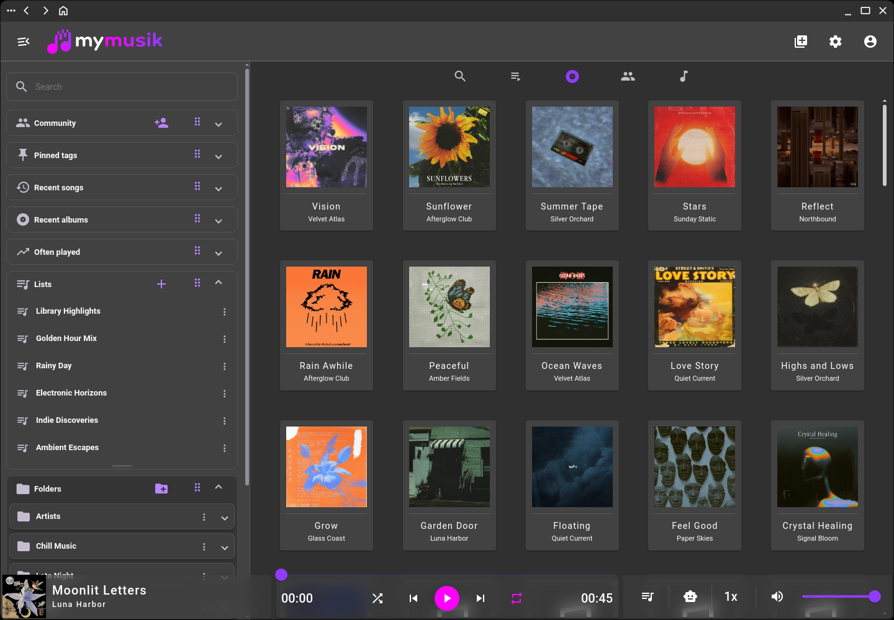
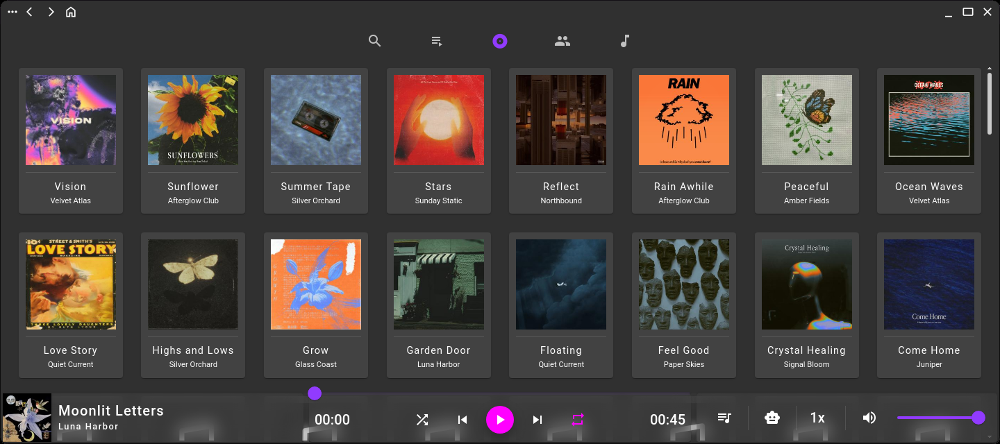
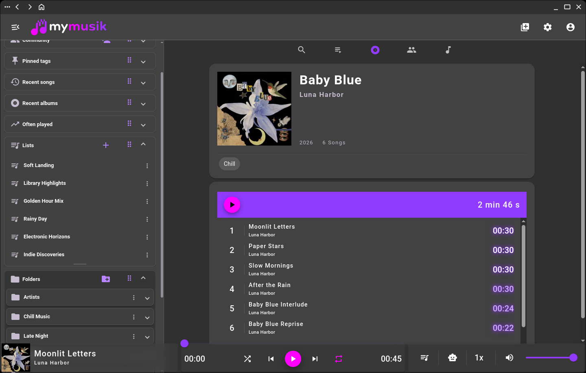
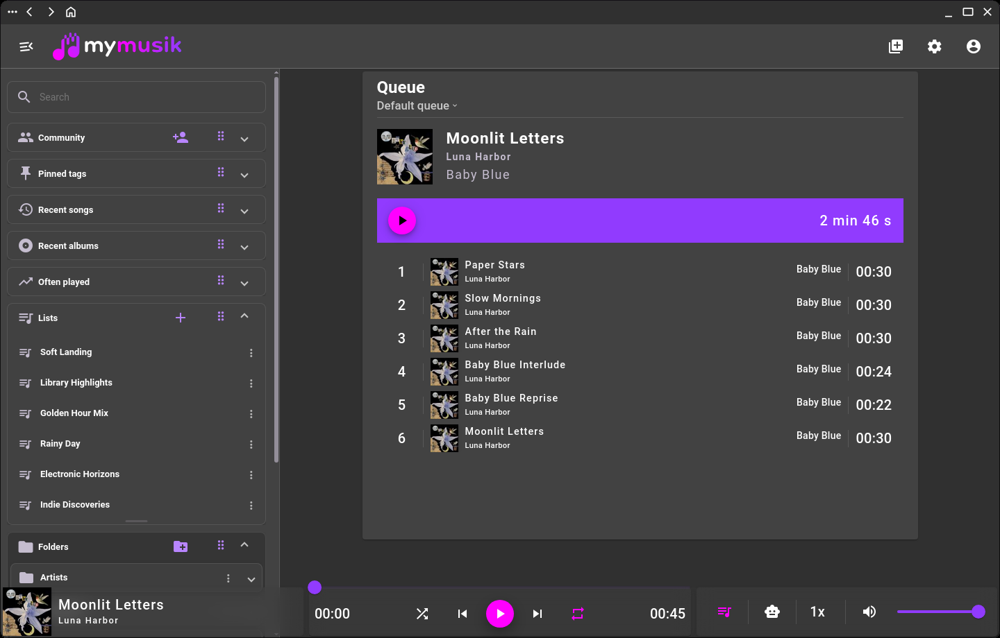
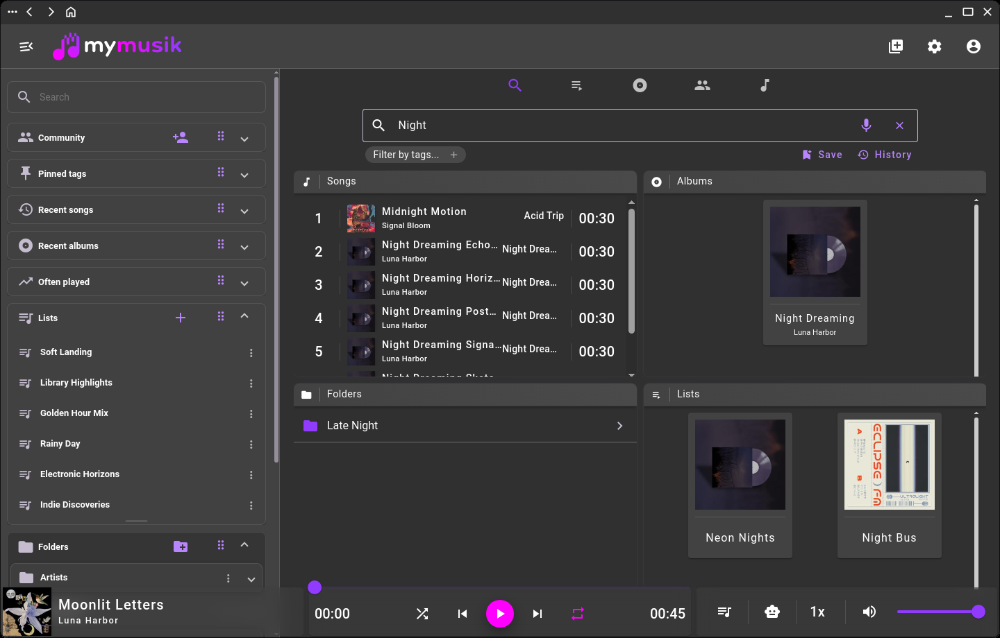

  

# MyMusik

Play and organize your personal music collection.

[Website](https://mymusik.app/) | [Download for Linux](https://mymusik.app/en/download/)

## Screenshots

MyMusik running on Linux.

### Album library

Browse your album collection with playlists in the side panel.

### Focused library view

Browse albums with the side panel and top navigation hidden.

### Album details

Explore album tracks and genre tags.

### Playback queue

View the current track and upcoming songs.

### Library search

Find songs, albums, folders and playlists.

